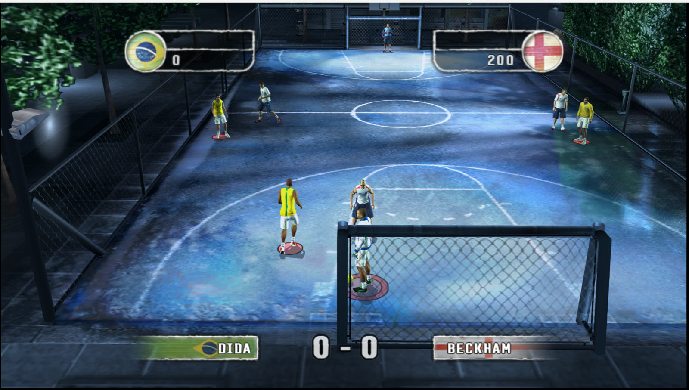
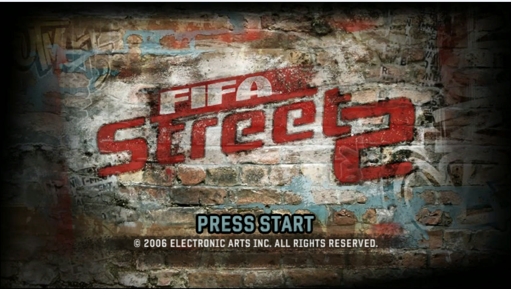
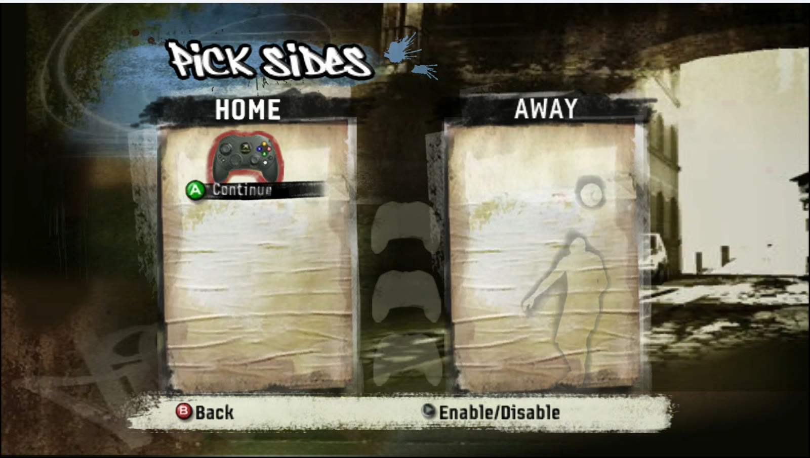

<h1 align="center">FIFA Street 2 — port nativo para PC</h1>

<p align="center"><i>FIFA Street 2 (Xbox) recompilado para rodar nativo no PC: 120 fps, widescreen, 4K, DLSS/FSR/XeSS e mods. Traga a sua cópia do jogo.</i></p>

<p align="center">
  <a href="https://github.com/otavix010/fifa-street-2-pc/releases/latest"></a>
  <a href="https://github.com/otavix010/fifa-street-2-pc/commits/main"></a>
  <a href="LICENSE"></a>
  <a href="https://github.com/otavix010/otavix-launcher/releases/latest"></a>
</p>

<p align="center">
  <a href="#destaques">Destaques</a> ·
  <a href="#instalar">Instalar</a> ·
  <a href="#versão-do-jogo">Versão do jogo</a> ·
  <a href="#requisitos">Requisitos</a> ·
  <a href="#mods">Mods</a>
</p>

Port nativo para Windows do **FIFA Street 2** do Xbox original, feito por recompilação estática com o
[Xbox XBE Recomp](https://github.com/TGP482/XboxXBE-Recomp): o código do jogo vira código de PC, sem emulador, com
gráficos e opções de PC.

> **O jogo não está incluído.** Você precisa da sua própria cópia. Este repositório e os pacotes de release não trazem
> nada do jogo: na primeira vez que abre, o port traduz o `default.xbe` da **sua** cópia e compila o código no seu PC.



## Destaques

- **60 fps** no ritmo original do jogo e **120 fps** com quadros intermediários calculados a partir do estado de
  desenho (sem geração por IA e sem acelerar o jogo).
- **Widescreen nativo** e qualquer resolução, até 4K e além.
- **Anti-aliasing temporal** com **DLSS** (NVIDIA RTX), **FSR** (qualquer placa) ou **XeSS**, com vetores de movimento
  e profundidade reais do jogo.
- Filtro anisotrópico, VRR (G-SYNC / FreeSync), V-sync, janela, sem bordas ou tela cheia.
- Controles de Xbox, PlayStation e Switch, com troca de botões e zona morta.
- **Teclado e mouse**: dá para jogar sem controle, com as teclas trocáveis (veja abaixo).
- Medidor de desempenho igual ao dos outros ports Otavix (fps, CPU, GPU e memória, nítido em qualquer resolução):
  liga em Configurações > Desempenho no launcher, e o F10 mostra ou esconde durante o jogo.
- **Mods** sem tocar no jogo: arquivos em `mods/<mod>/` substituem os do disco (veja abaixo).

| Tela inicial | Menu |
|---|---|
|  |  |

## Instalar

### Recomendado: pelo Otavix Launcher

O [Otavix Launcher](https://github.com/otavix010/otavix-launcher) baixa este port, instala o seu jogo a partir do arquivo
baixado (`.7z`, `.zip`, `.rar` ou `.iso`), confere a versão, cuida das opções, dos saves e dos mods. É o jeito mais
simples.

### Manual

1. Baixe `FIFAStreet2.zip` em [Releases](../../releases) e descompacte.
2. Coloque a sua cópia do jogo na pasta `assets`: a imagem `.iso` do disco ou os arquivos extraídos.
3. Abra `FIFAStreet2.exe`. Na primeira vez ele prepara o código do jogo para o seu PC (alguns minutos, só uma vez).
4. As opções ficam em `settings.toml`, ao lado do exe.

## Versão do jogo

| | |
|---|---|
| Jogo | FIFA Street 2 (USA) (En,Es), Xbox |
| `default.xbe` SHA-1 | `9c59ced6a2e361ba7130bb0dbfdb9106026574d5` |

Outras versões provavelmente não funcionam; o port avisa quando o `default.xbe` é diferente.

## Requisitos

- Windows 10 ou 11, 64 bits.
- Placa de vídeo com Direct3D 12. DLSS precisa de uma NVIDIA RTX; FSR e XeSS funcionam nas outras.
- Processador com SSE4.2 (praticamente qualquer um dos últimos 12 anos).

## Teclado e mouse

O teclado e o mouse funcionam como um controle na porta 1, junto com o controle que estiver ligado nela (ou sozinhos).
O mouse é o analógico direito (os dribles): um movimento rápido é um toque no analógico. Enquanto o mouse joga, o
cursor fica escondido e preso na janela; Alt+Tab solta.

| Tecla | Controle do Xbox | Ataque | Defesa |
|---|---|---|---|
| W A S D | Analógico esquerdo | Mover | Mover |
| Mouse ou 8 4 6 2 do teclado numérico | Analógico direito | Dribles (Trick Stick) | Trick Stick |
| K, Enter ou clique esquerdo | A | Passe rasteiro | Trocar de jogador |
| L, Backspace ou clique direito | B | Chute | Interceptar |
| J ou F | X | Passe alto | Carrinho |
| I, R ou botão do meio | Y | Exibição (Show Off) | Trocar para o goleiro |
| Espaço | Gatilho esquerdo | Trick Shift / proteger a bola | Andar de lado |
| Shift esquerdo | Gatilho direito | Trick Shift / turbo | Turbo |
| Setas | Direcional | Provocações (e os menus) | |
| Q / E | Branco / Preto | | |
| Esc | Start | Pausa | Pausa |
| Tab | Back | Replay | |
| Z / C | Clique dos analógicos | | |

Nos menus: W A S D ou as setas escolhem, Enter confirma, Backspace volta e Esc é o Start. F10 mostra o medidor.

Para trocar as teclas, edite o `settings.toml` ao lado do exe. Cada botão aceita várias teclas separadas por espaço:

```toml
keyboard = true          # false desliga o teclado e o mouse
keyboard_port = 1        # 1 a 4: use 2 para jogar teclado contra controle
mouse = true             # false deixa só o teclado
mouse_sensitivity = 50   # 1 a 200

[keys]
a = "k enter mouse1"
b = "l backspace mouse2"
x = "j f"
y = "i r mouse3"
white = "q"
black = "e"
lt = "space"
rt = "lshift"
start = "escape"
back = "tab"
ls = "z"
rs = "c"
up = "up"
down = "down"
left = "left"
right = "right"
stick_up = "w"
stick_down = "s"
stick_left = "a"
stick_right = "d"
rstick_up = "num8"
rstick_down = "num2"
rstick_left = "num4"
rstick_right = "num6"
```

Nomes das teclas (pela posição num teclado americano): letras e números, `f1` a `f12`, `space`, `enter`, `escape`,
`tab`, `backspace`, `lshift`, `rshift`, `lctrl`, `rctrl`, `lalt`, `ralt`, `capslock`, `up`, `down`, `left`, `right`,
`insert`, `delete`, `home`, `end`, `pageup`, `pagedown`, `num0` a `num9`, `numadd`, `numsub`, `nummul`, `numdiv`,
`numdec`, `numenter`, `minus`, `equals`, `lbracket`, `rbracket`, `semicolon`, `apostrophe`, `grave`, `backslash`,
`comma`, `period`, `slash`, e `mouse1` a `mouse5` (esquerdo, direito, meio e os dois laterais).

## Mods

Cada mod é uma pasta em `mods/`, com os arquivos no mesmo caminho do disco, por exemplo
`mods/MeuMod/data/aptanims/fe.viv`. Os mods ativos e a ordem ficam em `mods/ativos.txt` (o de cima vence). Um
`mod.toml` opcional dá nome, autor, versão e descrição. `OTAVIX_MODS=0` abre o jogo sem mods.

## Compilar

1. Visual Studio 2022 (ou Build Tools) com C++ e o componente Clang, CMake e Ninja.
2. `powershell -ExecutionPolicy Bypass -File scripts\baixar-sdks.ps1` baixa os SDKs de DLSS, FidelityFX e XeSS das
   fontes oficiais (eles não ficam no repositório).
3. `build.bat` compila; `release.bat` monta o `FIFAStreet2.zip` sem nada do jogo.

## Como é feito

**Como é feito:** o Otavix é um projeto de fãs, sem fins lucrativos, desenvolvido com a ajuda de assistentes de IA (Claude, da Anthropic), que escrevem e testam boa parte do código sob a direção do autor. Cada versão passa por testes antes de ser publicada, e os reports dos jogadores entram no mesmo ciclo.

**How it is made:** Otavix is a non-profit fan project developed with the help of AI assistants (Anthropic's Claude), which write and test much of the code under the author's direction. Every release is tested before it is published, and player reports feed the same loop.

## Créditos e licença

- Código deste port: [MIT](LICENSE).
- [Xbox XBE Recomp](https://github.com/TGP482/XboxXBE-Recomp) por TGP482 (MIT), em `sdk/`.
- NVIDIA DLSS, AMD FidelityFX e Intel XeSS sob as licenças dos fabricantes; demais bibliotecas em `sdk/THIRD_PARTY.txt`.
- FIFA Street 2 é marca da Electronic Arts. Este projeto não tem relação com a EA nem com a FIFA.

---

**English.** Native Windows port of the original Xbox FIFA Street 2, statically recompiled with Xbox XBE Recomp: 60 fps,
120 fps with in-between frames, native widescreen, any resolution, DLSS/FSR/XeSS anti-aliasing, mod support and **keyboard and mouse** (W A S D move, the mouse is the trick stick, K/Enter/left click A,
L/Backspace/right click B, J or F X, I or R Y, Space left trigger, left Shift right trigger, arrows D-pad, Q/E
white/black, Esc Start, Tab Back; keys can be changed in the `[keys]` table of `settings.toml`, see the table above). No game
data is included: the first start translates the `default.xbe` of your own copy on your PC. Easiest install: the
[Otavix Launcher](https://github.com/otavix010/otavix-launcher).

**Español.** Port nativo para Windows del FIFA Street 2 de la Xbox original. Se puede jugar con **teclado y ratón**:
W A S D mueven, el ratón es el stick derecho (los regates), K/Enter/clic izquierdo es A (pase raso), L/Retroceso/clic
derecho es B (tiro), J o F es X (pase alto), I o R es Y, Espacio es el gatillo izquierdo, Mayús izquierda el gatillo
derecho (turbo), las flechas son la cruceta, Q/E blanco/negro, Esc es Start y Tab es Back. Las teclas se cambian en la
tabla `[keys]` de `settings.toml` (ver la tabla de arriba). El juego no está incluido: necesitas tu propia copia.
