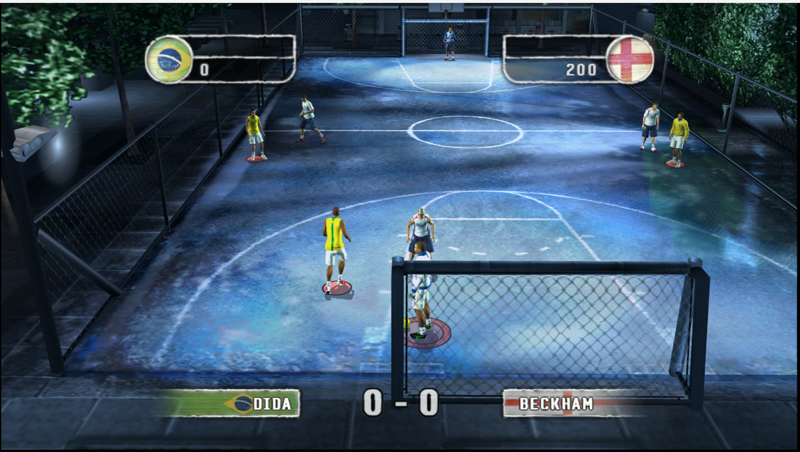
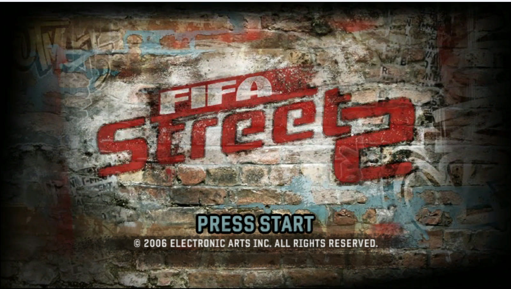
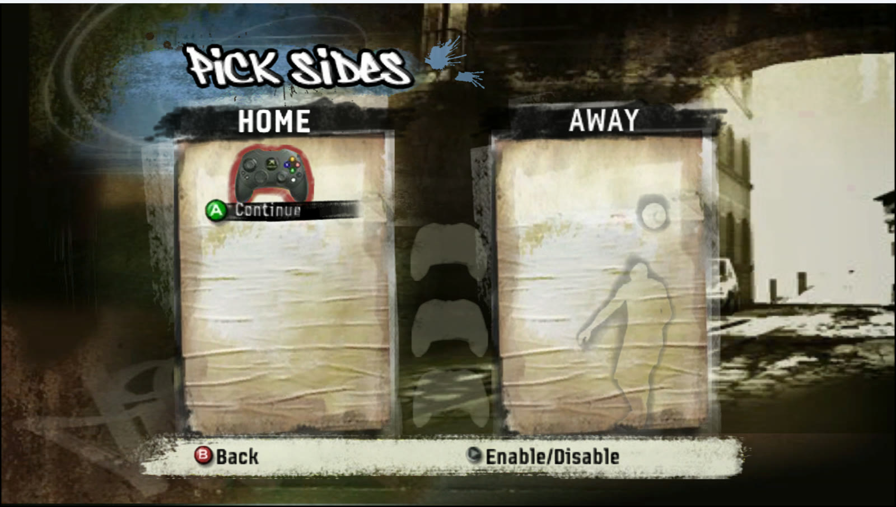

# FIFA Street 2 — port nativo para PC

Port nativo para Windows do **FIFA Street 2** do Xbox original, feito por recompilação estática com o
[Xbox XBE Recomp](https://github.com/TGP482/XboxXBE-Recomp): o código do jogo vira código de PC, sem emulador, com
gráficos e opções de PC.

> **O jogo não está incluído.** Você precisa da sua própria cópia. Este repositório e os pacotes de release não trazem
> nada do jogo: na primeira vez que abre, o port traduz o `default.xbe` da **sua** cópia e compila o código no seu PC.

## Destaques

- **60 fps** no ritmo original do jogo e **120 fps** com quadros intermediários calculados a partir do estado de
  desenho (sem geração por IA e sem acelerar o jogo).
- **Widescreen nativo** e qualquer resolução, até 4K e além.
- **Anti-aliasing temporal** com **DLSS** (NVIDIA RTX), **FSR** (qualquer placa) ou **XeSS**, com vetores de movimento
  e profundidade reais do jogo.
- Filtro anisotrópico, V-sync, janela, sem bordas ou tela cheia.
- Controles de Xbox, PlayStation e Switch, com troca de botões e zona morta.
- **Mods** sem tocar no jogo: arquivos em `mods/<mod>/` substituem os do disco (veja abaixo).

| Tela inicial | Menu |
|---|---|
|  |  |

## Instalar

### Recomendado: pelo Otavix Launcher

O [Otavix Launcher](https://github.com/otavix010/otavix-launcher) baixa este port, instala o seu jogo a partir do arquivo
baixado (`.7z`, `.zip`, `.rar` ou `.iso`), confere a versão, cuida das opções, dos saves e dos mods. É o jeito mais
simples.

### Manual

1. Baixe `FIFAStreet2.zip` em [Releases](../../releases) e descompacte.
2. Coloque a sua cópia do jogo na pasta `assets`: a imagem `.iso` do disco ou os arquivos extraídos.
3. Abra `FIFAStreet2.exe`. Na primeira vez ele prepara o código do jogo para o seu PC (alguns minutos, só uma vez).
4. As opções ficam em `settings.toml`, ao lado do exe.

## Versão do jogo

| | |
|---|---|
| Jogo | FIFA Street 2 (USA) (En,Es), Xbox |
| `default.xbe` SHA-1 | `9c59ced6a2e361ba7130bb0dbfdb9106026574d5` |

Outras versões provavelmente não funcionam; o port avisa quando o `default.xbe` é diferente.

## Requisitos

- Windows 10 ou 11, 64 bits.
- Placa de vídeo com Direct3D 12. DLSS precisa de uma NVIDIA RTX; FSR e XeSS funcionam nas outras.
- Processador com SSE4.2 (praticamente qualquer um dos últimos 12 anos).

## Mods

Cada mod é uma pasta em `mods/`, com os arquivos no mesmo caminho do disco, por exemplo
`mods/MeuMod/data/aptanims/fe.viv`. Os mods ativos e a ordem ficam em `mods/ativos.txt` (o de cima vence). Um
`mod.toml` opcional dá nome, autor, versão e descrição. `OTAVIX_MODS=0` abre o jogo sem mods.

## Compilar

1. Visual Studio 2022 (ou Build Tools) com C++ e o componente Clang, CMake e Ninja.
2. `powershell -ExecutionPolicy Bypass -File scripts\baixar-sdks.ps1` baixa os SDKs de DLSS, FidelityFX e XeSS das
   fontes oficiais (eles não ficam no repositório).
3. `build.bat` compila; `release.bat` monta o `FIFAStreet2.zip` sem nada do jogo.

## Créditos e licença

- Código deste port: [MIT](LICENSE).
- [Xbox XBE Recomp](https://github.com/TGP482/XboxXBE-Recomp) por TGP482 (MIT), em `sdk/`.
- NVIDIA DLSS, AMD FidelityFX e Intel XeSS sob as licenças dos fabricantes; demais bibliotecas em `sdk/THIRD_PARTY.txt`.
- FIFA Street 2 é marca da Electronic Arts. Este projeto não tem relação com a EA nem com a FIFA.

---

**English.** Native Windows port of the original Xbox FIFA Street 2, statically recompiled with Xbox XBE Recomp: 60 fps,
120 fps with in-between frames, native widescreen, any resolution, DLSS/FSR/XeSS anti-aliasing and mod support. No game
data is included: the first start translates the `default.xbe` of your own copy on your PC. Easiest install: the
[Otavix Launcher](https://github.com/otavix010/otavix-launcher).
